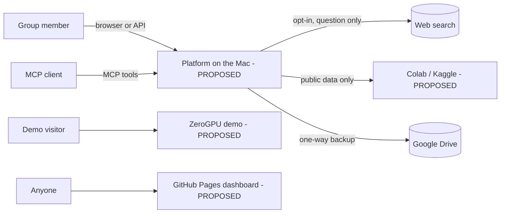

# Software Requirements Specification

| Field | Value |
|---|---|
| Purpose | Single entry point to the planned system requirements |
| Status | Proposed |
| Last updated | 2026-10-31 |
| Source of truth | [WORK_PLAN.md](../WORK_PLAN.md) v1.9 |
| Related documents | [Functional requirements](../01-requirements/functional-requirements.md), [Non-functional requirements](../01-requirements/non-functional-requirements.md), [Business rules](../01-requirements/business-rules.md) |

> Implementation status: Phase 0 in progress. Only the step 0.1 project setup exists as code (settings, database layer, Alembic). This document describes the planned system. Nothing here is verified behaviour.

## 1. Purpose

Specify the planned Local Multi-Agent RAG Platform v1 so it can be built phase by phase and reviewed by the MDU group.

## 2. Scope

See [project scope](../00-project-overview/project-scope.md).

## 3. Stakeholders and user classes

See [stakeholders](../00-project-overview/stakeholders.md) and [user types](../02-users-and-permissions/user-types.md).

## 4. System context

## 5. Requirements

| Type | Document | Count |
|---|---|---|
| Functional | [functional-requirements.md](functional-requirements.md) | 57 |
| Non-functional | [non-functional-requirements.md](non-functional-requirements.md) | 32 |
| Business rules | [business-rules.md](business-rules.md) | 16 |

## 6. Constraints, assumptions and dependencies

See [constraints and assumptions](constraints-and-assumptions.md). Phase dependencies are in WORK_PLAN.md section 10.2.

## 7. Acceptance

See [acceptance criteria](acceptance-criteria.md).

## 8. Status

All requirements are proposed and not implemented. Supervisor approval: REQUIRES CONFIRMATION.
