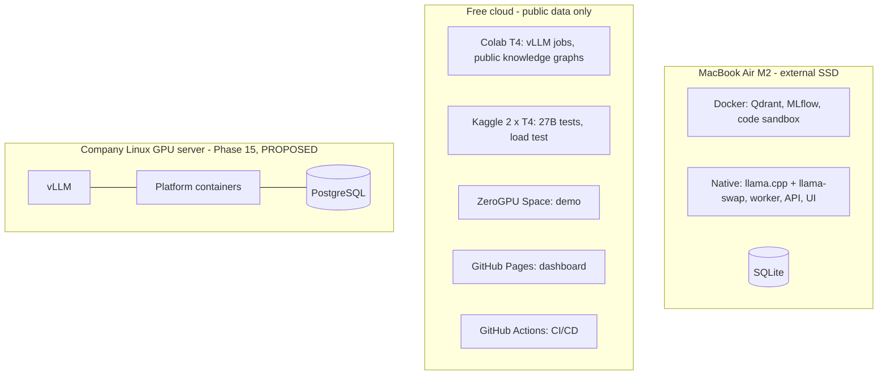

# Deployment architecture

| Field | Value |
|---|---|
| Purpose | Where each part runs in each profile |
| Status | Proposed |
| Last updated | 2026-10-31 |
| Source of truth | [WORK_PLAN.md](../WORK_PLAN.md) v1.9 |
| Related documents | [Deployment guide](../10-deployment-and-operations/deployment-guide.md), [Environment configuration](../10-deployment-and-operations/environment-configuration.md) |

> Implementation status: Phase 0 in progress. Only the step 0.1 project setup exists as code (settings, database layer, Alembic). This document describes the planned system. Nothing here is verified behaviour.

| Profile | Runs | Data allowed |
|---|---|---|
| Mac | Full platform | Private and public |
| GPU | Batch jobs | Public only |
| Demo | Demo app | Public samples |
| CI | Tests | Public fixtures |
| Company server | Full platform in containers | Company data inside its network |

Model servers run natively on the Mac because containers there cannot use the Metal GPU (WORK_PLAN.md section 6, ADR-002).
