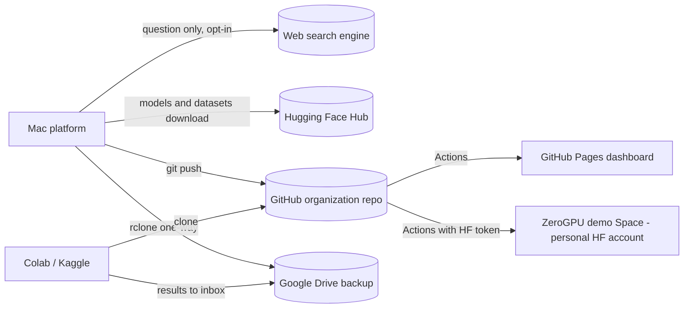

# Integration architecture

| Field | Value |
|---|---|
| Purpose | External services and how the platform connects to them |
| Status | Proposed |
| Last updated | 2026-11-03 |
| Source of truth | [WORK_PLAN.md](../WORK_PLAN.md) v1.9 |
| Related documents | [External integrations](../06-api/external-integrations.md) |

> Implementation status: Phase 0 done (project setup, search database, Mac model server, model client and backup). Later features are planned and not built yet. Test results are in docs/HANDOVER.md.

All arrows are PROPOSED. Details per service are in [external integrations](../06-api/external-integrations.md).
