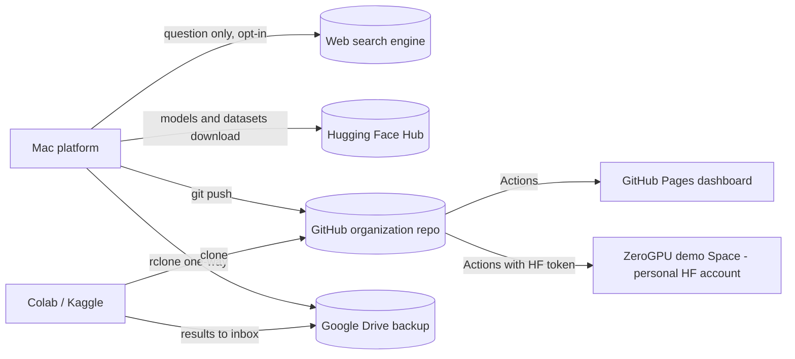

# Integration architecture

| Field | Value |
|---|---|
| Purpose | External services and how the platform connects to them |
| Status | Proposed |
| Last updated | 2026-10-31 |
| Source of truth | [WORK_PLAN.md](../WORK_PLAN.md) v1.9 |
| Related documents | [External integrations](../06-api/external-integrations.md) |

> Implementation status: Phase 0 in progress. Only the step 0.1 project setup exists as code (settings, database layer, Alembic). This document describes the planned system. Nothing here is verified behaviour.

All arrows are PROPOSED. Details per service are in [external integrations](../06-api/external-integrations.md).
