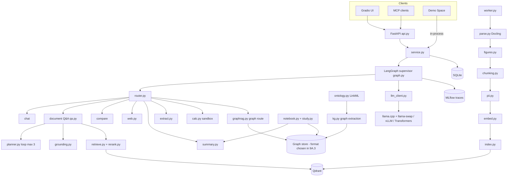
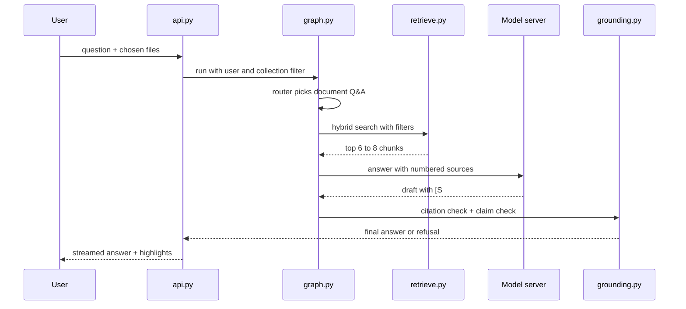
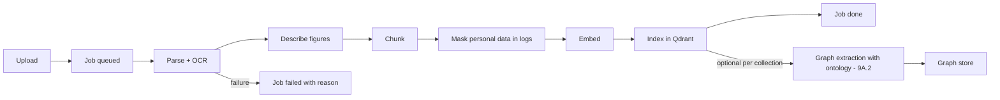

# System architecture

| Field | Value |
|---|---|
| Purpose | Components, data flow and boundaries of the planned system |
| Status | Proposed |
| Last updated | 2026-10-31 |
| Source of truth | [WORK_PLAN.md](../WORK_PLAN.md) v1.9 |
| Related documents | [Backend architecture](../04-architecture/backend-architecture.md), [Integration architecture](../04-architecture/integration-architecture.md), [Threat model](../07-security/threat-model.md) |

> Implementation status: Phase 0 in progress. Only the step 0.1 project setup exists as code (settings, database layer, Alembic). This document describes the planned system. Nothing here is verified behaviour.

All diagrams show the PROPOSED design from WORK_PLAN.md section 8.1. No component exists yet.

## Component diagram (PROPOSED)

## Request flow for a cited answer (PROPOSED)

## Ingestion workflow (PROPOSED)

## Boundaries

| Boundary | Inside | Outside |
|---|---|---|
| Privacy | Mac: private files, index, MLflow | Colab, Kaggle, GitHub, Drive, demo, dashboard |
| Trust | Code, configs | File text, web pages, user input (treated as data) |
| Failure | Each route has a fallback (7.4) | — |

## Scaling

One user on the Mac first. Multi-user server with Postgres and vLLM in Phase 15. Multi-server scaling is a non-goal for v1.
