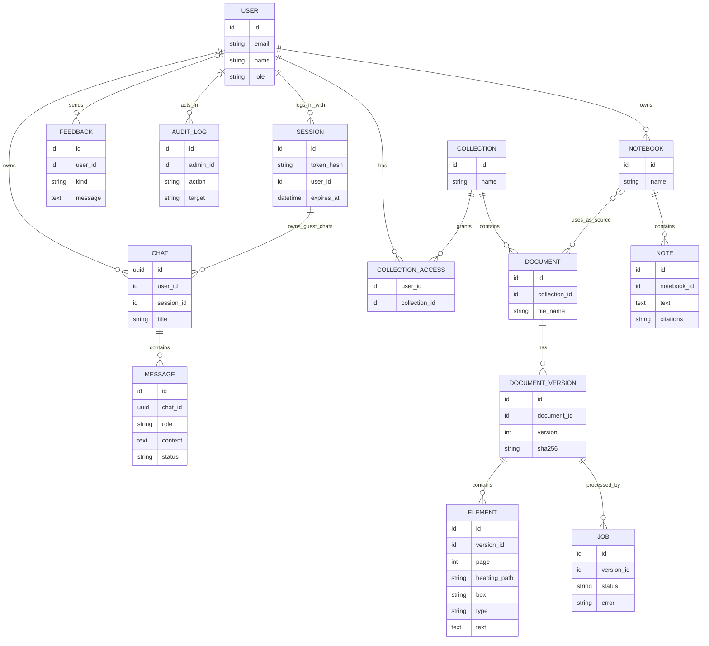

# ER diagram

| Field | Value |
|---|---|
| Purpose | Proposed relational entities |
| Status | Proposed |
| Last updated | 2026-11-15 |
| Source of truth | [WORK_PLAN.md](../WORK_PLAN.md) v1.10 |
| Related documents | [Data dictionary](../05-database/data-dictionary.md) |

> Implementation status: see docs/WORK_PLAN.md, section 1 (current state). Test results are in docs/HANDOVER.md.

PROPOSED. Entity and field names are suggestions built from WORK_PLAN.md steps 3.1, 3.4, 3.5 and 12.4. They are finalised when those steps start. USER, SESSION, CHAT, MESSAGE, FEEDBACK and AUDIT_LOG exist since step 1.10 (src/mrag/db.py). The other entities are still proposed.

The state of running requests (LangGraph checkpointer), vectors (Qdrant), the knowledge graph (graph store) and traces (MLflow) live in their own stores and are not drawn here. NOTEBOOK and NOTE come from step 9B.1. Their storage is not decided: REQUIRES CONFIRMATION.
