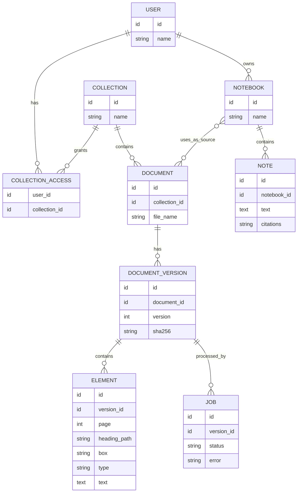

# ER diagram

| Field | Value |
|---|---|
| Purpose | Proposed relational entities |
| Status | Proposed |
| Last updated | 2026-10-31 |
| Source of truth | [WORK_PLAN.md](../WORK_PLAN.md) v1.9 |
| Related documents | [Data dictionary](../05-database/data-dictionary.md) |

> Implementation status: Phase 0 in progress. Only the step 0.1 project setup exists as code (settings, database layer, Alembic). This document describes the planned system. Nothing here is verified behaviour.

PROPOSED. Entity and field names are suggestions built from WORK_PLAN.md steps 3.1, 3.4, 3.5 and 12.4. They are finalised when those steps start.

Chat threads (LangGraph), vectors (Qdrant), the knowledge graph (graph store) and traces (MLflow) live in their own stores and are not drawn here. NOTEBOOK and NOTE come from step 9B.1. Their storage is not decided: REQUIRES CONFIRMATION.
