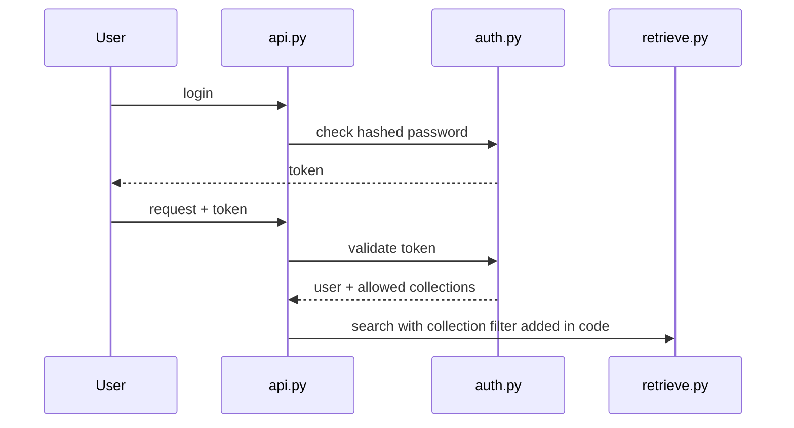

# Authentication and authorization

| Field | Value |
|---|---|
| Purpose | Single policy for login and access |
| Status | Proposed |
| Last updated | 2026-10-31 |
| Source of truth | [WORK_PLAN.md](../WORK_PLAN.md) v1.9 |
| Related documents | [Access control policy](../02-users-and-permissions/access-control-policy.md), [API authentication](../06-api/authentication.md) |

> Implementation status: Phase 0 in progress. Only the step 0.1 project setup exists as code (settings, database layer, Alembic). This document describes the planned system. Nothing here is verified behaviour.

## Planned flow (PROPOSED, Phase 13)

| Item | Plan | Open |
|---|---|---|
| Passwords | Stored hashed (13.1) | Hash method REQUIRES CONFIRMATION |
| Tokens | Issued at login (13.1) | Type, lifetime and revocation REQUIRES CONFIRMATION |
| Authorization | Collection filter in retrieve.py (5.3, 12.4) | Admin rights REQUIRES CONFIRMATION |
| Before Phase 13 | No login | Recommendation SF-01: listen only on the Mac itself |
