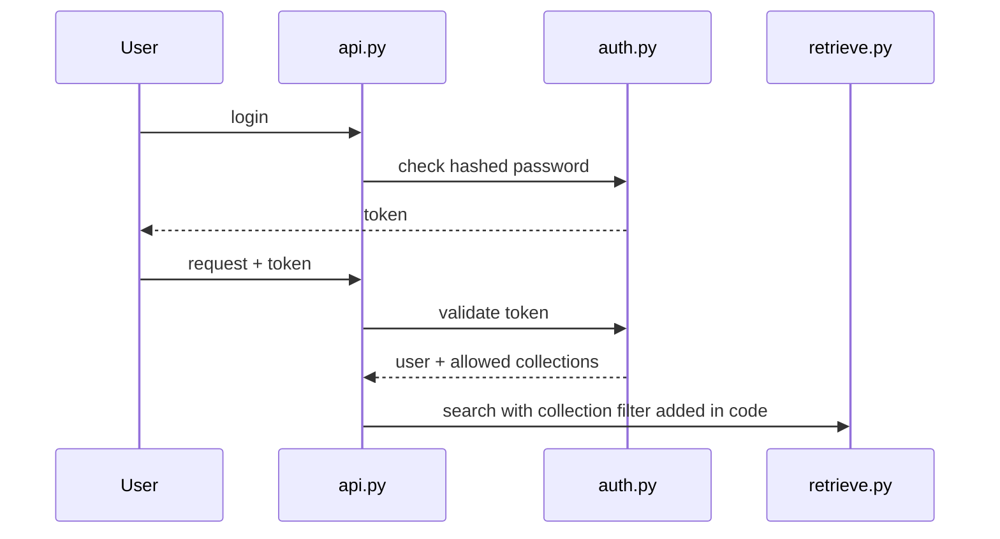

# Authentication and authorization

| Field | Value |
|---|---|
| Purpose | Single policy for login and access |
| Status | Proposed |
| Last updated | 2026-11-04 |
| Source of truth | [WORK_PLAN.md](../WORK_PLAN.md) v1.9 |
| Related documents | [Access control policy](../02-users-and-permissions/access-control-policy.md), [API authentication](../06-api/authentication.md) |

> Implementation status: Phase 0 done (project setup, search database, Mac model server, model client and backup). Later features are planned and not built yet. Test results are in docs/HANDOVER.md.

## Planned flow (PROPOSED, 1.10 and Phase 13)

| Item | Plan | Open |
|---|---|---|
| Passwords | Stored hashed (1.10) | Hash method chosen in 1.10 (OWASP Password Storage Cheat Sheet) |
| Tokens | Session cookie from 1.10. Tokens for other apps (13.1) | Type, lifetime and revocation set in 1.10 and 13.1 |
| Authorization | Collection filter in retrieve.py (5.3, 12.4) | Admin rights REQUIRES CONFIRMATION |
| Before step 1.10 | No login | Recommendation SF-01: listen only on the Mac itself |
