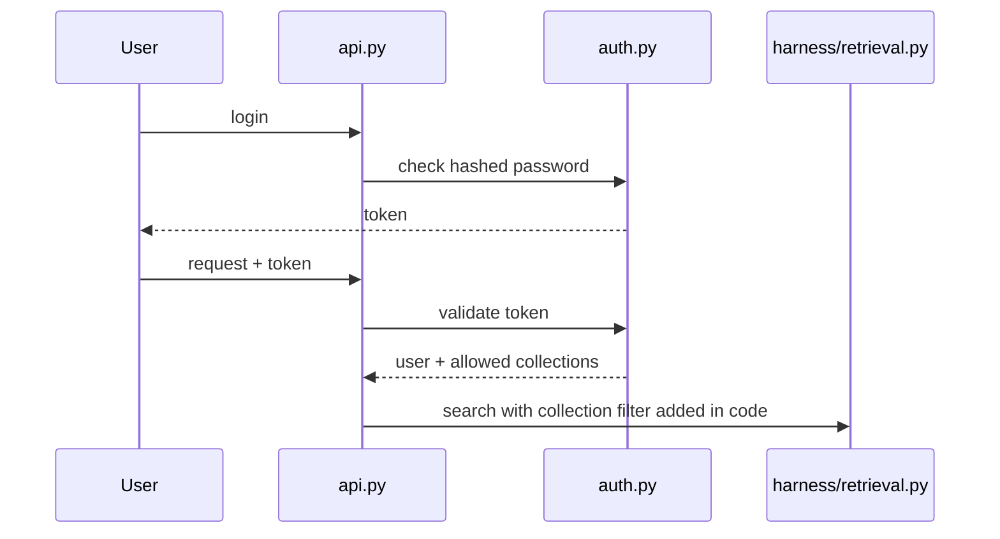

# Authentication and authorization

| Field | Value |
|---|---|
| Purpose | Single policy for login and access |
| Status | Proposed |
| Last updated | 2026-11-15 |
| Source of truth | [WORK_PLAN.md](../WORK_PLAN.md) v1.10 |
| Related documents | [Access control policy](../02-users-and-permissions/access-control-policy.md), [API authentication](../06-api/authentication.md) |

> Implementation status: see docs/WORK_PLAN.md, section 1 (current state). Test results are in docs/HANDOVER.md.

## Planned flow (PROPOSED, 1.10 and Phase 13)

| Item | Plan | Open |
|---|---|---|
| Passwords | Argon2id through argon2-cffi, 15 to 128 characters, common passwords refused (1.10, D49) | Login throttling in 13.1 |
| Tokens | Session on the server with its token in an HttpOnly cookie, only its SHA-256 stored, 30 minutes without use or 12 hours in total (1.10, D49). Tokens for other apps (13.1) | Type, lifetime and revocation of tokens for other apps set in 13.1 |
| Forged requests | A token per session in forms and in the header X-CSRF-Token, plus the Origin and Sec-Fetch-Site check (1.10, D49) | — |
| Roles | Member and admin (1.10, D37). Admins manage users, settings and feedback and never see chat text. Guests only while an admin allows guest mode (D49) | Collection rights in 12.4 |
| Authorization | Collection filter in harness/retrieval.py (5.3, 12.4) | Admin rights REQUIRES CONFIRMATION |
| Before step 1.10 | No login | Recommendation SF-01: listen only on the Mac itself |
