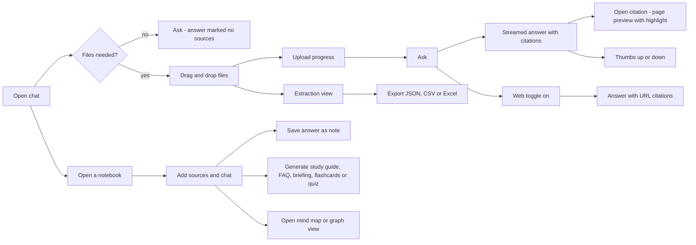

# User flows

| Field | Value |
|---|---|
| Purpose | Planned main flows through the UI |
| Status | Proposed |
| Last updated | 2026-10-31 |
| Source of truth | [WORK_PLAN.md](../WORK_PLAN.md) v1.9 |
| Related documents | [Use cases](../02-users-and-permissions/use-cases.md), [Screen specifications](../08-ui-ux/screen-specifications.md) |

> Implementation status: Phase 0 in progress. Only the step 0.1 project setup exists as code (settings, database layer, Alembic). This document describes the planned system. Nothing here is verified behaviour.

PROPOSED, based on step 13.2. The flows are refined when Phase 13 starts.
