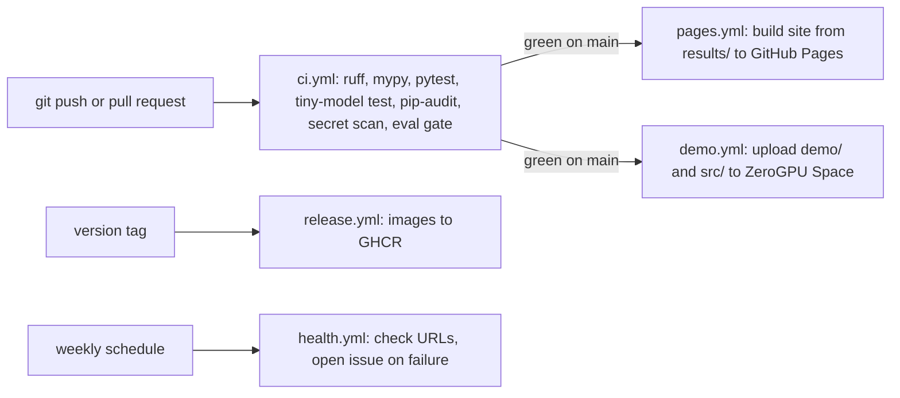

# CI/CD pipeline

| Field | Value |
|---|---|
| Purpose | Planned GitHub Actions workflows |
| Status | Proposed |
| Last updated | 2026-10-31 |
| Source of truth | [WORK_PLAN.md](../WORK_PLAN.md) v1.9 |
| Related documents | [Testing strategy](../09-testing/testing-strategy.md), [Git workflow](../11-development-standards/git-workflow.md) |

> Implementation status: Phase 0 in progress. Only the step 0.1 project setup exists as code (settings, database layer, Alembic). This document describes the planned system. Nothing here is verified behaviour.



| Workflow | Trigger | Step |
|---|---|---|
| ci.yml | Every push and pull request | 1.4 |
| pages.yml | CI green on main | 1.7 |
| demo.yml | CI green on main | 1.8 |
| health.yml | Weekly | 1.9 |
| release.yml | Version tag | 15.1 |

Cost guard: public repo, standard runners only, small artifacts with short retention (rule Z, 1.4). Dependabot proposes security updates (1.4).

## Live website: how it works and updates (WORK_PLAN.md section 11, word for word)

| Part | What it is | Before the full API (Phases 1 to 12) | After Phase 13 |
|---|---|---|---|
| Live dashboard | Static site on GitHub Pages: progress (done / not done per step), scores over versions, architecture, changelog, example cited answers on public documents | Built from results/ files that Mac, Colab or Kaggle runs exported and committed | Same, plus the final report |
| Live demo | Gradio app on a ZeroGPU Space with public sample documents | Calls service.py directly inside the Space. Gradio also exposes a free public API for the demo functions | Same UI as the full platform |
| Full API | FastAPI on the Mac (and later on company servers) | Grows every phase under /v1 (experimental) | Login, rate limits, frozen /v1, MCP |

Update flow on every push:

```
git push → CI on GitHub Actions (lint, types, tests, score check, security scan)
             │ only if green and on main
             ├─→ pages.yml: build site from results/ → GitHub Pages (live in minutes)
             └─→ demo.yml: upload demo/ and src/mrag/ → ZeroGPU Space (rebuilds itself)
weekly: health.yml checks both URLs and opens a GitHub issue if one is down
```
